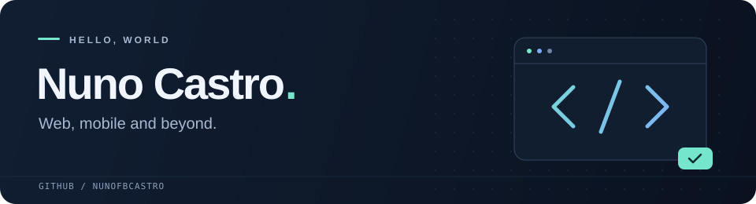

  

  
  

## Hello, I'm Nuno

Welcome to my corner of GitHub. My toolkit spans web and Android development, backend systems, and experiments with games and hardware.

Browse my [repositories](https://github.com/nunofbcastro?tab=repositories) to see what I've been working on, or [connect with me on LinkedIn](https://www.linkedin.com/in/nunofbcastro/).

## My toolkit

  
  
  
  
  
  

| Area | Languages & tools |
| :--- | :--- |
| **Frontend** | HTML · CSS · JavaScript · TypeScript · React · Next.js · Angular · Tailwind CSS |
| **Mobile** | Android · Kotlin · Jetpack Compose |
| **Backend & languages** | Node.js · C# · .NET · Python · Java · C |
| **Data** | MongoDB · Microsoft SQL Server · MySQL · Firebase |
| **Games & hardware** | Unity · Arduino |
| **Development tools** | Git · GitLab · Linux |

## A little activity, a little snake

<picture>
  <source media="(prefers-color-scheme: dark)" srcset="https://raw.githubusercontent.com/nunofbcastro/nunofbcastro/output/github-contribution-snake-dark.svg" />
  <source media="(prefers-color-scheme: light)" srcset="https://raw.githubusercontent.com/nunofbcastro/nunofbcastro/output/github-contribution-snake.svg" />
  
</picture>

  Thanks for stopping by. Have a look around.

